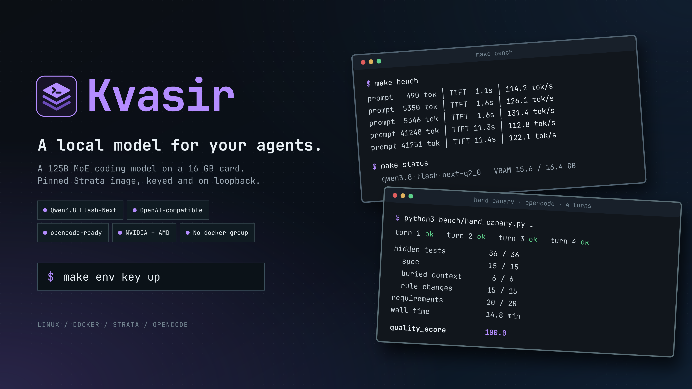

#  Kvasir



**A local, OpenAI-compatible endpoint for coding agents that runs a 125B
mixture-of-experts model on a 16 GB graphics card.**

Kvasir runs [Strata](https://github.com/Niko1221/Strata), from its
official pinned image, serving Qwen3.8 Flash-Next. Strata keeps the most-used
experts on the card, the rest in RAM, and a lookup shard on NVMe. The model
choice follows Akita's
[llm-opensource-benchmark](https://github.com/akitaonrails/llm-opensource-benchmark),
where the 2-bit Q2_0 build matched the 3-bit one on a hard multi-turn opencode
test.

On an RTX 4080 with 60 GB of RAM it decodes at 113-131 tok/s and scored
100/100 (36/36 hidden tests) on that same test.

## Quick start

```sh
git clone https://github.com/mateuspim/kvasir
cd kvasir
make env          # .env for this machine; then set STRATA_DATA_DIR (NVMe)
make key          # API key, mode 600
make plan         # what would download; changes nothing
make up           # first start downloads ~72 GB and builds a ~38 GB pack
make status
```

Then [connect opencode](docs/guide/opencode.md) or any OpenAI client to
`http://127.0.0.1:8080/v1` with the key as a bearer token.

## Features

- Qwen3.8 Flash-Next at Q2_0 by default; other sizes and families by changing
  `MODEL` ([what fits your RAM](docs/guide/hardware.md)).
- OpenAI-compatible chat with tool calling, streaming and image input.
- NVIDIA and AMD through one switch, `GPU_VENDOR`, with the matching Strata
  image. AMD is untested.
- Endpoint on loopback only, always keyed; the key reaches the container as a
  compose secret.
- No docker group: docker runs through `pkexec` by default.
- `make bench` and `make curl-test` to check speed and tool calling
  ([benchmarks](docs/guide/benchmarks.md)).
- Offline config tests that run in CI and as a pre-commit hook.

## Requirements

- Linux x86-64 with Docker and Compose v2.
- NVIDIA RTX 20-50 with driver 580+ and nvidia-container-toolkit, or a
  supported AMD card.
- RAM is the limit, not VRAM: about 44 GB for Q2_0.
- About 105 GB free on an NVMe drive.

Details and other sizes: [choose hardware and a model](docs/guide/hardware.md).

## Remove

```sh
make down
rm -rf "$STRATA_DATA_DIR"            # model data, ~105 GB
rm ~/.config/kvasir/strata.key    # or your STRATA_KEY_FILE
```

Nothing else was installed on the host.

## Security and privileges

Docker commands run as root through `pkexec`; nothing else here needs root.
The container sees the GPU, the data directory and the key file. The endpoint
listens on `127.0.0.1` and rejects requests without the key. The first start
downloads model files from Hugging Face. Full privilege model:
[SECURITY.md](SECURITY.md).

## Everyday use

```sh
make status       # GPU, RAM, served model
make logs         # follow the server
make restart      # after editing .env
make bench        # speed, with the GPU otherwise idle
make curl-test    # tool calling end to end
```

To switch models, change `MODEL` in `.env`, run `make plan` to see the
download, then `make restart`. All variables and targets:
[configuration spec](docs/specs/configuration.md).

## Measured

RTX 4080 16 GB, Ryzen 9 9900X, 60 GB RAM, image `0.2.7-cuda13`, Q2_0 at 128K
context:

| Prompt | Time to first token | Decode |
| --- | --- | --- |
| ~5.3K tokens | 1.6 s | 126-131 tok/s |
| ~41K tokens | 11.3 s | 113-122 tok/s |

Hard canary: 100/100 in 14.8 min (Akita's RTX 5090: 100 in 7.1 min).
Methods and caveats: [benchmarks](docs/guide/benchmarks.md).

## Documentation

- [Documentation index](docs/README.md): guides, architecture, decisions,
  specs and runbooks.
- [Troubleshooting](docs/runbooks/troubleshooting.md).
- [Contributing](CONTRIBUTING.md) and [Security](SECURITY.md).

## Development

`make test` runs the offline suite; CI runs the same. Setup, tests, upgrading
Strata and releases: [development runbook](docs/runbooks/development.md).
Rules for people and coding agents: [AGENTS.md](AGENTS.md).

## License

[MIT](LICENSE) © 2026 Mateus Pim. Strata and the models have their own
licenses.
